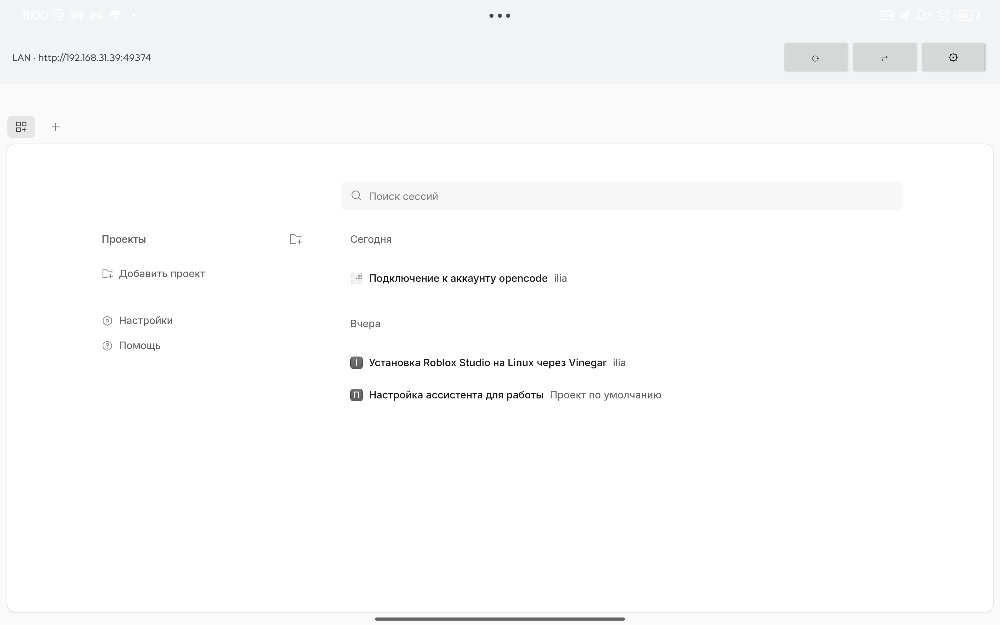

# CodeTether

Android-клиент для [OpenCode](https://opencode.ai), работающего на вашем компьютере.
Планшет или телефон подключается к серверу OpenCode **в локальной сети** и **через интернет**
(Tailscale), переключаясь между ними автоматически.

> Неофициальный клиент. Не связан с проектом OpenCode и не поддерживается им.
> Название и логотип OpenCode принадлежат их владельцам.

**Страница загрузки:** https://frantishak0.github.io/codetether




## Быстрый старт

**1. На компьютере** — одна команда, она настроит сервер и покажет QR:

```bash
curl -fsSL https://raw.githubusercontent.com/frantishak0/codetether/main/scripts/setup-server.sh | bash
```

Скрипт включает прослушивание локальной сети, задаёт пароль сервера, открывает порт
в ufw, подхватывает адрес Tailscale и печатает QR-код.

**2. На телефоне** — установите APK из [релизов](https://github.com/frantishak0/codetether/releases/latest),
откройте приложение и нажмите **📷** — наведите камеру на QR. Адреса LAN/WAN и пароль
подставятся сами.

Готово: приложение работает в домашней сети, а вне дома автоматически уходит на Tailscale.

### Без QR

Ссылку из вывода скрипта (`codetether://setup?d=…`) можно отправить себе в мессенджер
и открыть на телефоне — приложение примет её как deep link. Либо впишите адреса вручную
кнопкой **⚙**.

## Обновления

Приложение само проверяет новые релизы на GitHub (раз в сутки и по кнопке **⬆**) и
предлагает обновиться — скачивает APK и открывает системный установщик.

## Возможности

- Автоматический выбор пути: локальная сеть (быстро) → Tailscale (работает откуда угодно).
- Ручное переключение LAN ⇄ WAN и повторная проверка доступности.
- Авторизация по HTTP Basic (пароль сервера), пароль хранится в `EncryptedSharedPreferences`.
- Загрузка файлов из веб-интерфейса OpenCode, полноценная история навигации по кнопке «Назад».
- Подключение одним сканированием QR (`scripts/setup-server.sh` печатает код настройки).
- Автообновление из GitHub Releases.
- Edge-to-edge, локализация: English, Русский.

## Как это работает

```
[Android]  ──LAN──▶  http://192.168.x.x:49374
     │                        │
     └────Tailscale──▶  http://100.x.y.z:49374
                              ▼
                   opencode serve (ваш компьютер)
```

Приложение периодически проверяет оба адреса (`GET /api/info`, ответ 401 тоже считается
доступностью) и загружает веб-интерфейс OpenCode в WebView с той стороны, которая отвечает.

## Подготовка сервера вручную

Если не хотите запускать скрипт, сделайте то же самое руками:

```bash
opencode service set hostname 0.0.0.0
opencode service set password "длинный-секрет"
opencode service start
sudo ufw allow from 192.168.0.0/16 to any port 49374 proto tcp
```

Для доступа из интернета — [Tailscale](https://tailscale.com) на компьютере и на планшете:

```bash
curl -fsSL https://tailscale.com/install.sh | sh && sudo tailscale up
sudo ufw allow in on tailscale0
tailscale ip -4          # этот адрес указывается как WAN
```


## Windows

Приложение не зависит от ОС сервера — на Windows всё работает так же. Отличия:

| | Linux | Windows |
|---|---|---|
| Порт сервера по умолчанию | `49374` | `28894` |
| Файрвол | `ufw` | Windows Defender Firewall |
| Скрипт настройки | `scripts/setup-server.sh` | `scripts/setup-server.ps1` |

**Установка OpenCode** — пакетные менеджеры Windows не поддерживаются, берите готовый архив:
[opencode-windows-x64.zip](https://opencode.ai/update/api/latest/cli/opencode/opencode-windows-x64.zip)
(или `npm install -g @opencode/cli`, если установлен Node.js).

**Настройка сервера и QR:**

```powershell
powershell -ExecutionPolicy Bypass -File .\scripts\setup-server.ps1
```

Скрипт сам определит порт, создаст правило файрвола (нужны права администратора)
и напечатает QR. QR рисуется через Node.js (`npm`), если он установлен; иначе будет
выведена ссылка `codetether://setup?d=…`.

### OpenCode внутри WSL2

WSL2 сидит за NAT, поэтому телефон не увидит сервер напрямую. Два пути:

**1. Mirrored networking** (Windows 11 22H2+) — в `%UserProfile%\.wslconfig`:

```ini
[wsl2]
networkingMode=mirrored
```

**2. Проброс порта** (Windows 10/11), в PowerShell от администратора:

```powershell
$wslIp = (wsl hostname -I).Trim().Split()[0]
netsh interface portproxy add v4tov4 listenport=49374 listenaddress=0.0.0.0 `
  connectport=49374 connectaddress=$wslIp
New-NetFirewallRule -DisplayName 'CodeTether WSL' -Direction Inbound -Action Allow `
  -Protocol TCP -LocalPort 49374 -Profile Private
```

Внутри WSL запустите bash-версию скрипта:

```bash
curl -fsSL https://raw.githubusercontent.com/frantishak0/codetether/main/scripts/setup-server.sh | bash
```

> Адрес WSL меняется после перезагрузки — при необходимости обновите правило `portproxy`.

## Настройка приложения

Кнопка **⚙** — адреса и пароль:

| Поле | Пример |
|---|---|
| LAN | `http://192.168.31.39:49374` |
| WAN | `http://100.104.12.20:49374` |
| Таймаут | `800` мс |
| Пароль | пароль сервера OpenCode |

## Сборка

Нужны JDK 17+, Android SDK 36.

```bash
./gradlew assembleRelease     # APK
./gradlew bundleRelease       # AAB
```

Подпись берётся из `keystore.properties` (не коммитится) или переменных
`CT_STORE_FILE`, `CT_STORE_PASSWORD`, `CT_KEY_ALIAS`, `CT_KEY_PASSWORD`.
Без них release-сборка собирается неподписанной.

## Конфиденциальность

Приложение не содержит аналитики, рекламы и не отправляет данные третьим лицам.
Все соединения идут напрямую к вашему серверу OpenCode. Подробнее — [PRIVACY.md](PRIVACY.md).

## Лицензия

MIT — см. [LICENSE](LICENSE).
